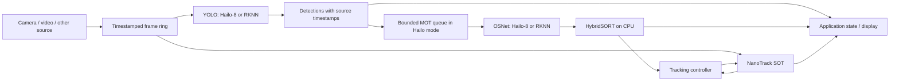

# GIMB

### Real-time detection and tracking on embedded accelerators

**YOLO · HybridSORT · NanoTrack · Hailo-8 · RK3588**

An embedded computer-vision application that combines object detection, multi-object tracking and single-target tracking. YOLO and OSNet can run on independently selected accelerators while the application preserves frame timestamps and its existing tracking-controller interface.

[Setup](docs/SETUP.md) · [Architecture](docs/ARCHITECTURE.md) · [Measured performance](docs/PERFORMANCE.md) · [Русское описание](docs/README_RU.md)

---

## Why this project

Running a detector quickly is only one part of a real-time system. GIMB addresses the integration work around it: feeding asynchronous batches without losing intervening frames, bounding stale work, retaining the association between frames and results, and connecting detections to multi-object and single-target tracking.

The current implementation targets **Orange Pi 5 / RK3588 with a PCIe Hailo-8**. It is a hardware-dependent engineering project, with hardware-free regression tests for the accelerator adapters. It is not a turnkey desktop demo.

## Capabilities

- **Independent accelerator selection:** YOLO on Hailo or RKNN; OSNet ReID on Hailo or RKNN. HybridSORT association remains on the CPU.
- **Full-frame and tiled detection:** full-frame batches contain different source frames; tiled batches contain image slices, followed by coordinate restoration and class-wise NMS.
- **Asynchronous Hailo inference:** reusable input/output slots with explicit ownership until results have been consumed.
- **Bounded real-time processing:** timestamp-ordered reads from the source ring and stale-backlog trimming; a separate MOT worker in the Hailo integration.
- **MOT → SOT handoff:** HybridSORT tracks feed the existing tracking controller; NanoTrack retains its RKNN backbone and ONNX Runtime head.
- **Camera and file inputs:** direct OpenCV camera capture and clock-paced video playback. Existing RTSP, shared-memory and image-folder adapters are retained.
- **Stage-level measurements:** completed YOLO/MOT FPS, decode time, batch preparation, Hailo readiness wait, submission-to-callback latency and collection time.

## Architecture at a glance



## Quick start

Use a Linux **Python 3.10+** environment with the vendor runtimes appropriate to your board. Start with [the setup guide](docs/SETUP.md); compiled models and vendor drivers are not included.

```bash
python -m pip install -r requirements.txt
cp config/local.example.py config/local.py
# Edit model paths and source settings in config/local.py.
python -m src.gimb
```

An example mixed configuration:

```python
# config/local.py — executed after config/config.py
# Existing configuration classes are available here.
detector_backend = "hailo"
mot_backend = "rknn"
frame_source = "video"
DatasetVideoPath.tv_n = str(ROOT / "data/input.mp4")
Detector.use_sahi = False
Hailo.yolo_hef = str(ROOT / "models/yolov11s_per.hef")
Hailo.full_frame_batch = 4
Hailo.full_frame_max_wait_ms = 120
Hailo.inflight = 2
```

Set `frame_source = "camera"` and configure `CameraCapture` to use a camera. Requesting 60 FPS does not guarantee that the camera delivers 60 FPS at the chosen resolution and pixel format.

## Measurements, with scope

| Measurement | Observed result | What it measures |
|---|---:|---|
| YOLO11s HEF benchmark, Hailo-8, 640×640, 6 classes, 2 contexts | **52.12 FPS streaming** | Standalone benchmark reported by HailoRT; not full application throughput |
| Integrated full-frame YOLO, 1920×1080 file at 29.97 FPS, batch 4 | **28–30.7 FPS after startup** | Completed detector results in short rolling windows with MOT/SOT also running |
| OSNet HEF standalone, including crop preparation | **203.2 crops/s** | Separate ReID validation run; not tracking frames/s |

These are development measurements supplied from the target device, not reproducible guarantees for arbitrary models, scenes or boards. The integrated 30 FPS source does **not** establish 50–60 FPS operation with a camera. MOT can remain substantially slower than YOLO. See [methodology and limits](docs/PERFORMANCE.md).

## Repository layout

```text
config/                 Shared settings and ignored machine-specific overrides
src/gimb/               Application entry point, controllers, sources and state
src/framework/hailo/    Hailo YOLO/ReID, RKNN bridges, geometry and metrics
src/framework/det/      Existing detector implementations
src/framework/mot/      MOT factories and ReID wrappers
src/framework/sot/      Single-object trackers
boxmot/                 Existing local BoxMOT implementation; see provenance notes
models/                 Model configuration files; weights supplied separately
examples/               Hardware-specific and legacy examples
benchmarks/             Existing transport benchmarks
tests/hailo_backend/   Hardware-free accelerator regression tests
```

## Validation

```bash
python -m pip install -r requirements-test.txt
python -m unittest discover -s tests/hailo_backend -v
python -m compileall -q src config boxmot
```

The adapter suite covers frame/result timestamps, async buffer ownership, padding, cancellation, backend selection, video pacing, retained source frames and stale-backlog trimming. Hailo/RKNN devices are mocked. Passing these tests does not establish hardware compatibility, detection accuracy or ID quality.

## Current limitations

- CPU preparation, decoding and scheduling affect performance even when inference is offloaded.
- Some source frames may be dropped to bound latency under overload; processing every frame is not promised in real-time mode.
- Camera source FPS is not yet included in the new `source` counter; that counter is implemented for file playback.
- MOT throughput and identity quality require their own evaluation on representative sequences.
- Some legacy examples need additional dependencies; STARK support requires a separately supplied package and models.
- The local BoxMOT copy is retained for compatibility. Its changes should be reviewed before replacing it with a stock package.

## Attribution and distribution

This repository integrates existing detection/tracking libraries; it does not claim authorship of YOLO, HybridSORT, OSNet, NanoTrack or BoxMOT. See [third-party and licensing notes](THIRD_PARTY_NOTICES.md). Model weights, datasets, vendor SDKs, local logs and original Git history are not included in this source snapshot. No new project-wide license has been assigned in this preparation.
